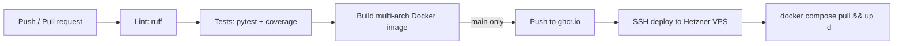

# Trading Analyst Bot

[](https://github.com/Andreas-Yianni/Stock_trading_bot/actions/workflows/ci.yml)

A Python bot that analyses US stocks and crypto with technical indicators and news sentiment, suggests entry, stop-loss and position size, and paper-trades the signals automatically through the Alpaca API. It runs 24/7 in Docker on a cloud server and every merge to `main` is tested and deployed automatically.

> **Paper trading only.** This is a learning and portfolio project. No analysis predicts the market reliably, and the bot never uses real money.

## Features

- **Analysis engine** – trend and momentum indicators (EMA, RSI, ATR), support/resistance levels and news sentiment, combined into a score from -100 to +100 with a trade plan (entry, stop-loss, trailing stop, position size based on account risk).
- **Backtesting** – replays a strategy over years of history per symbol or across the whole watchlist, with fees and portfolio-level stats.
- **Automated paper trading** – a daily scan of the top 100 US stocks places paper orders on Alpaca, with safety limits (max positions, max new trades per day, max order size, daily loss limit).
- **AI second opinion (optional)** – the Google Gemini API reviews the same data and returns a structured JSON opinion. It is logged and compared with real outcomes; it does not change signals by default.
- **Telegram bot** – run analyses, scans and backtests from your phone (`/scan`, `/news`, `/backtest`, `/trades`, `/stats` and more) and get alerts on new signals.
- **Streamlit dashboard** – charts, analysis, news, watchlist scan and trade journal in the browser.

## Tech stack

| Area | Tools |
|---|---|
| Language | Python 3.14 |
| Data & analysis | pandas, NumPy, yfinance, ccxt, VADER sentiment |
| Integrations | Alpaca API (paper trading), Telegram Bot API, Google Gemini API |
| UI | Telegram, Streamlit, Plotly, mplfinance |
| Quality | pytest (95 tests, network fully mocked), ruff, coverage |
| DevOps | Docker, Docker Compose, GitHub Actions, GitHub Container Registry, Dependabot |
| Hosting | Hetzner Cloud VPS (Ubuntu 24.04, Arm64) |

## Architecture

```
tradebot/
  market.py, cache.py        market data (stocks via yfinance, crypto via ccxt) with caching
  indicators.py, levels.py   technical indicators and support/resistance
  news.py, events.py         news feeds, sentiment, upcoming earnings/macro events
  engine.py                  combines all factors into a score and a trade plan
  ai.py                      optional Gemini opinion (JSON, cached, logged)
  backtest.py, strategies.py historical simulation and strategy comparison
  autoscan.py, broker.py     daily scan and Alpaca paper orders with risk limits
  journal.py, portfolio.py   trade journal and performance stats
telegram_bot.py              Telegram interface and scheduled jobs
dashboard.py                 Streamlit dashboard
cli.py                       command-line analysis and backtests
```

## CI/CD pipeline



- Pull requests run lint, tests and a Docker build; `main` is protected and needs a green CI.
- On `main`, the image is built for amd64 and arm64, pushed to GitHub Container Registry and deployed over SSH with a restricted deploy key that can only run `deploy.sh`.
- On the server the bot writes a heartbeat every minute; a Docker healthcheck and a watchdog restart it and send a Telegram alert if it gets stuck.
- The server firewall only allows SSH; the dashboard is reached through an SSH tunnel.

Full server setup: [`deploy/README.md`](deploy/README.md).

## Run locally

```bash
python -m venv .venv
source .venv/bin/activate          # Windows: .venv\Scripts\activate
pip install -r requirements.txt
cp .env.example .env               # add your Telegram, Alpaca (paper) and optional Gemini keys
```

```bash
python cli.py AAPL 1d              # analyse one symbol
python cli.py AAPL 1d --backtest   # backtest it
streamlit run dashboard.py         # dashboard on http://localhost:8501
python telegram_bot.py             # Telegram bot
```

Or with Docker:

```bash
docker compose up -d --build       # bot + dashboard
docker compose logs -f bot
```

Run the tests:

```bash
pip install -r requirements-dev.txt
pytest --cov
```

Settings such as balance, risk per trade, watchlist and broker limits live in `config.yaml`. A full list of Telegram commands (in Greek) is in [`ΟΔΗΓΟΣ_ΕΝΤΟΛΩΝ.md`](ΟΔΗΓΟΣ_ΕΝΤΟΛΩΝ.md).

## How it was built

I built this project with Claude Code as a pair programmer. I set the direction, reviewed and tested each change, and worked in feature branches merged through pull requests with CI checks. Strategy ideas that failed in backtests were documented and rejected rather than shipped (see `research/`).

## Author

Andreas Yianni – Computer Engineering & Informatics student, Cyprus University of Technology
[GitHub](https://github.com/Andreas-Yianni) · [LinkedIn](https://www.linkedin.com/in/andreas-yianni-38503320a/)
